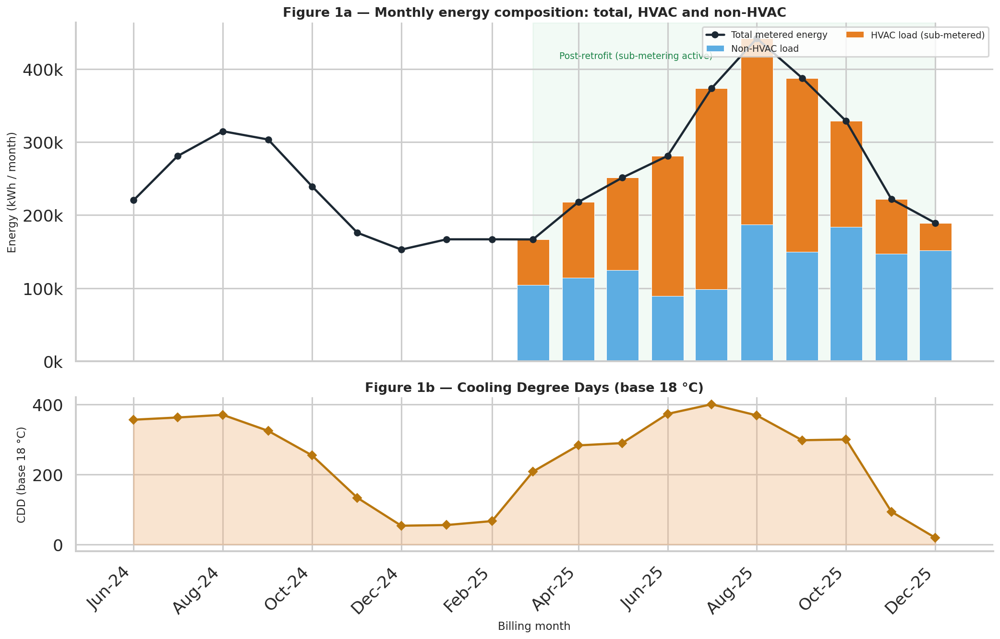
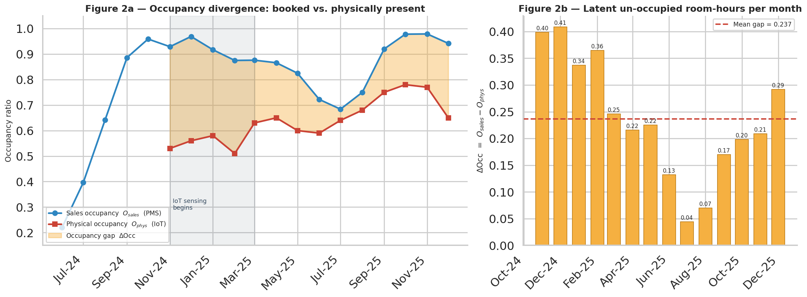
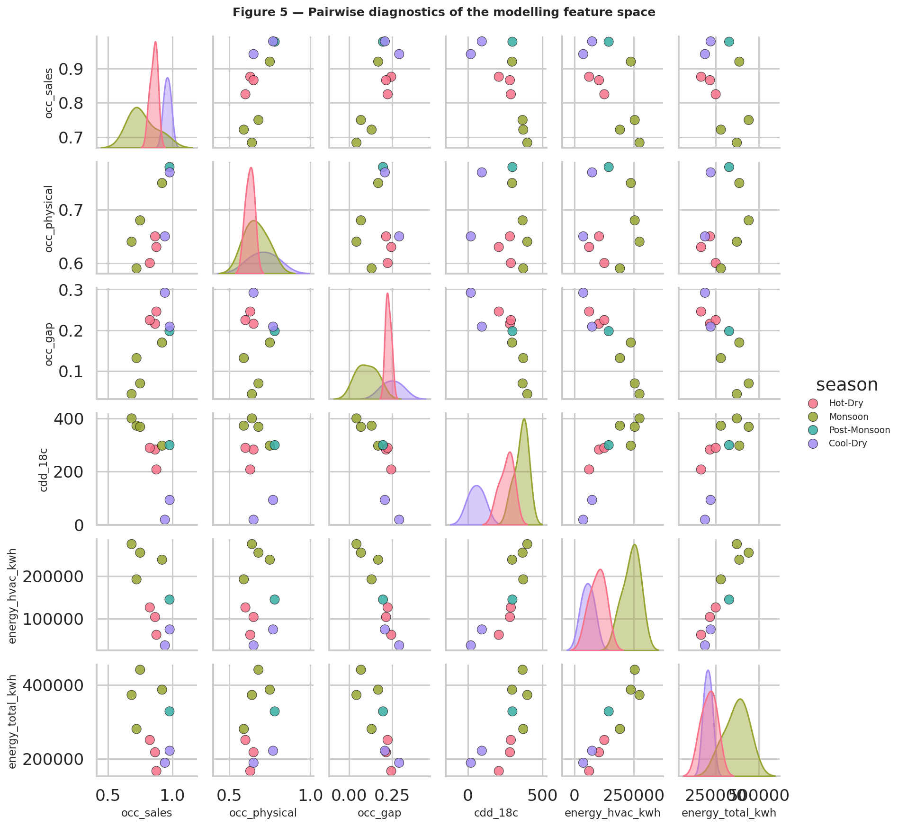
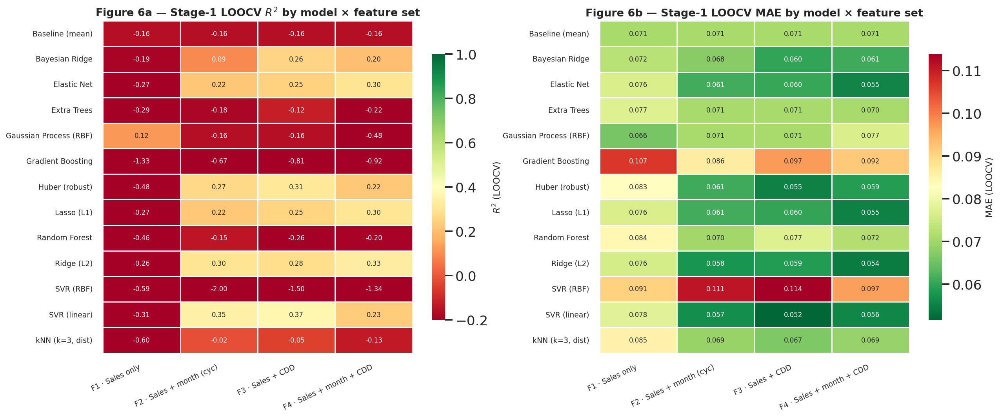
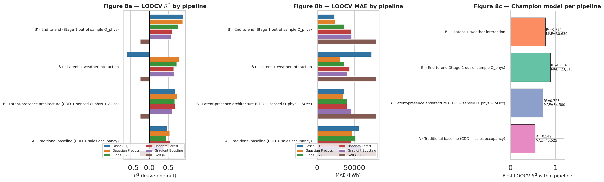
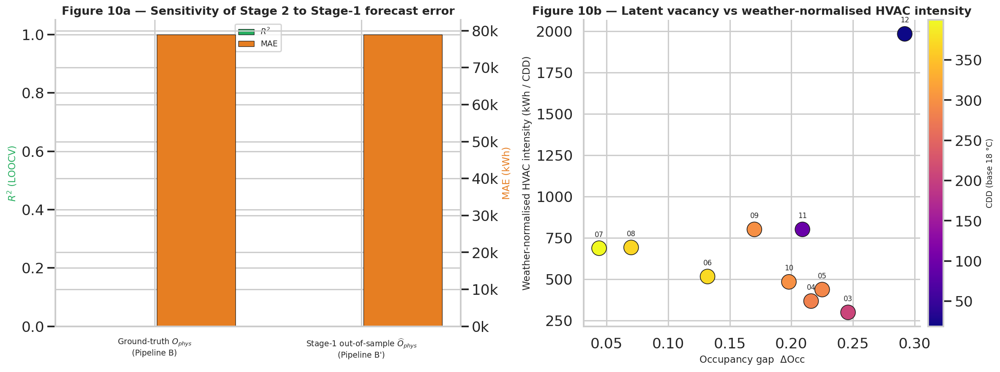
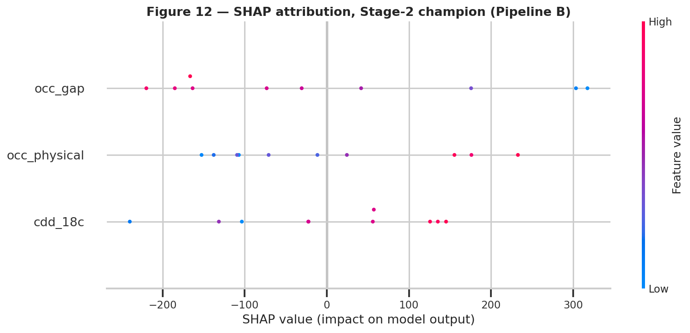

## Hotel Booking Energy Prediction — Dynamic HVAC Wattage

Forecasting hotel HVAC energy by first reconstructing latent in-room occupancy (from booking telemetry) and then using that occupancy along with weather and building signals to predict dynamic energy load.

## Key ideas
- Use hotel booking telemetry to impute/forecast latent physical occupancy (the "occupancy gap") and feed that into an energy prediction model for HVAC load.
- Two-stage modeling: Stage 1 — latent occupancy forecasting/imputation; Stage 2 — energy (wattage) prediction using occupancy + environmental and automation signals.
- Emphasis on interpretability (SHAP), diagnostics, and scenario analysis (setback scenarios and error propagation).

## Top results
- Energy vs weather overview: 
  
- Occupancy divergence & imputation diagnostics: 
  
- Feature correlation & pairwise relationships: 
  
- Stage 1 benchmark & diagnostics: 
  
- Stage 2 pipeline diagram and diagnostics:
  
- Error propagation and scenario analysis: 
  
- Model interpretability (SHAP): 
  

## Repository layout
- artefact/         — exported matplotlib figures used in this README and the notebook
- notebook/         — Jupyter notebook(s) with markdown, code and executable analysis
- data/             — raw / processed datasets used by the notebook (see notebook for details)
- report/           — optional PDF/report artifacts

## How to reproduce
1. Clone the dev branch:
   git clone --branch dev https://github.com/AryDataLabs/Hotel_Booking_Energy_prediction.git
2. Create environment and install dependencies (example):
   python -m venv .venv
   source .venv/bin/activate
   pip install -r requirements.txt
   (If no requirements.txt exists, use Python 3.8–3.10 and install common libs: pandas, numpy, scikit-learn, xgboost/lightgbm, shap, matplotlib, seaborn, jupyter)
3. Open and run the notebook:
   jupyter lab notebook/Forecasting_Latent_In_Room_Physical_Occupancy.ipynb
   or execute headless:
   jupyter nbconvert --to notebook --execute notebook/Forecasting_Latent_In_Room_Physical_Occupancy.ipynb --ExecutePreprocessor.timeout=600

## Notes and provenance
- The notebook `notebook/Forecasting_Latent_In_Room_Physical_Occupancy.ipynb` contains the full narrative, code, and cell-by-cell steps used to generate the figures in artefact/.
- Two authored documents referenced in the repository root (for citation and further reading):
  1. Bridging the Occupancy Gap — Bridging_Occupancy_Gap.docx
  2. Forecasting Latent In-Room Physical Occupancy — Forecasting_Latent_Occupancy.docx

Here is the first generated paper:
1. `Bridging the Occupancy Gap AI-Driven Latent Presence Imputation for Building Energy Baseline Reconstruction` a.k.a *Bridging_Occupancy_Gap.docx*
2. `Forecasting Latent In-Room Physical Occupancy from Hotel Booking Telemetry for Dynamic Energy Load Prediction` a.k.a *Forecasting_Latent_Occupancy.docx*
